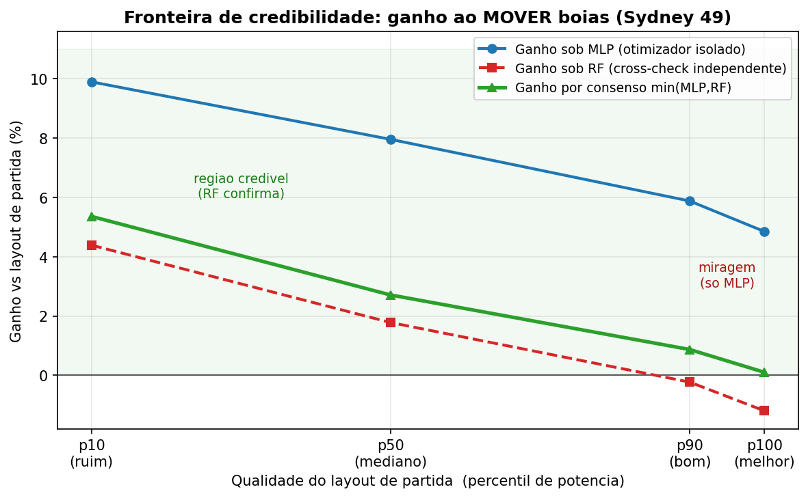

# Quantum-behaved PSO (QPSO) for Wave Energy Converter (WEC) Layout Optimization

> **Notice:** Copyright (c) 2026 Anthony Oliveira. All rights reserved. See [LICENSE](LICENSE) for details.
> Code, documentation, and figures in this repository are published for scholarly inspection and reference. Reproduction, redistribution, or reuse in derivative works requires prior written permission from the copyright holder.

---

## Overview

This repository provides an implementation of **Quantum-behaved Particle Swarm Optimization (QPSO)** combined with **machine learning surrogate models** to solve the high-dimensional layout optimization problem for **Wave Energy Converter (WEC)** farms.

### What is QPSO?
Quantum-behaved Particle Swarm Optimization (QPSO) is a physics-inspired metaheuristic grounded in quantum mechanics and the Heisenberg uncertainty principle. In classical PSO, particles navigate search spaces via velocity and Newtonian kinematics. In contrast, QPSO assumes particles exist in a quantum state within a delta potential well:
- Particle positions are sampled from a double exponential probability distribution centered around a local stochastic attractor.
- The absence of velocity vectors reduces hyperparameter tuning (governed primarily by a contraction-expansion coefficient $\alpha$).
- Simulated quantum tunneling enables particles to overcome high-energy barrier regions, preventing premature convergence to suboptimal local extrema.

### The WEC Layout Problem
Optimizing the placement of wave energy converters (e.g., 49 or 100 submerged buoys within a designated offshore lease area) is critical for maximizing total energy harvest. However:
- Buoys interact hydrodynamically (destructive wave interference and shadow effects reduce aggregate electrical output).
- High-fidelity computational fluid dynamics (BEM hydrodynamic simulations) require hours to days per layout evaluation.
- Surrogate modeling (Random Forest and smooth Multi-Layer Perceptron ensembles) allows rapid continuous and discrete search evaluations.
- To prevent optimization algorithms from exploiting surrogate inaccuracies ("extrapolating into unverified high-power regions"), we introduce **Consensus Optimization** ($\min(\hat{P}_\mathrm{MLP}, \hat{P}_\mathrm{RF})$) and Lower Confidence Bound (LCB) trust regions, ensuring all reported gains are credible by construction.

---

## Repository Structure

```text
qpso-wec-layout/
├── qpso_continuo.py              # Continuous QPSO core (LCB trust-region, boundary clamping, distance repair)
├── qpso_discreto.py              # Discrete QPSO core for buoy selection via SHAP-additive surrogate fitness
├── surrogate.py                  # Smooth MLP ensemble & Random Forest surrogate interfaces
├── shared_utils.py               # Dataset loading, surrogate training, coordinate handling & SHAP utilities
├── bench_funcs.py                # Smooth analytical benchmark surfaces for verification without datasets
├── experimento_consenso.py       # Consensus optimization (min(MLP, RF)) to eliminate surrogate extrapolation mirages
├── experimento_mover.py          # Continuous repositioning experiments on suboptimal layouts
├── experimentos.py               # Systematic multi-seed ablation and distance constraint experiments
├── qpso_continuo_run.py          # End-to-end continuous optimization run on WEC benchmark
├── qpso_discreto_run.py          # End-to-end discrete buoy selection run on WEC benchmark
├── test_*.py                     # Comprehensive pytest test suite (23 test cases)
├── resultado_imgs/               # Visualizations (buoy coordinates, heatmaps, convergence)
├── resultados_master/            # Aggregated benchmark convergence plots
└── resultados_todos_datasets/    # Comparative performance plots across sites
```

---

## Dataset Acquisition and Setup

The experiments utilize benchmark datasets from real-sea hydrodynamic evaluations for 49-buoy wave farms located in **Sydney** and **Perth**.

### Dataset Reference
The dataset was produced from the wave farm layout benchmark introduced by:
> Neshat, M., Alexander, B., Sergiienko, N. Y., & Wagner, M. (2020). *Optimisation of Large Wave Farms using a Multi-strategy Evolutionary Framework*. In *Proceedings of the 2020 Genetic and Evolutionary Computation Conference (GECCO '20)*, pp. 1150–1158. DOI: [10.1145/3377930.3390235](https://doi.org/10.1145/3377930.3390235).
> *(UNVERIFIED: Associated with the "Large-scale Wave Energy Farm" benchmark hosted on public academic repositories such as the UCI Machine Learning Repository or University of Adelaide repository; please check the original publication DOI for updated mirror links).*

### Expected Placement and Format
Scripts query SQLite database files in the repository root directory with a table named `wec_data`:
- `WEC_Sydney_49.db`
- `WEC_Perth_49.db`

If you have acquired the raw CSV files (`WEC_Sydney_49.csv` and `WEC_Perth_49.csv`), place them in the repository root and convert them into SQLite format with this one-liner:

```python
import sqlite3
import pandas as pd

for site in ["Sydney", "Perth"]:
    csv_file = f"WEC_{site}_49.csv"
    db_file = f"WEC_{site}_49.db"
    df = pd.read_csv(csv_file)
    with sqlite3.connect(db_file) as conn:
        df.to_sql("wec_data", conn, if_exists="replace", index=False)
    print(f"Created {db_file} successfully.")
```

---

## Quickstart

### 1. Installation
Clone the repository and install dependencies:
```bash
git clone https://github.com/StaffeToxic/qpso-wec-layout.git
cd qpso-wec-layout
pip install -r requirements.txt
```

### 2. Run Test Suite
The full test suite validates continuous and discrete QPSO mechanics, surrogate bounds, and convergence behavior using synthetic and analytic surfaces (no dataset required):
```bash
python -m pytest -v
```

### 3. Run Consensus Optimization
With dataset files in place, execute consensus optimization to test credible buoy repositioning:
```bash
python experimento_consenso.py
```

### 4. Validate Surrogates
Evaluate surrogate fitting ($R^2$ and MAE) across train/test splits:
```bash
python surrogate_validation.py
```

---

## Results and Visualizations

### 1. Credibility Frontier: Eliminating Extrapolation Mirages
Continuous optimization on single surrogates can lead particles into unphysical predictions. By enforcing consensus between independent models ($\min(\hat{P}_\mathrm{MLP}, \hat{P}_\mathrm{RF})$), gains are verified across both architectures:



### 2. Multi-Algorithm Convergence Across Sites
Comparison of hybrid evolutionary and quantum-inspired methods:


### 3. Optimized Buoy Positioning
Example of spatial configuration of 49 WEC buoys under hydrodynamic and spatial boundary constraints:


---

## License

Copyright (c) 2026 Anthony Oliveira. All rights reserved.
See [LICENSE](LICENSE) for terms.
