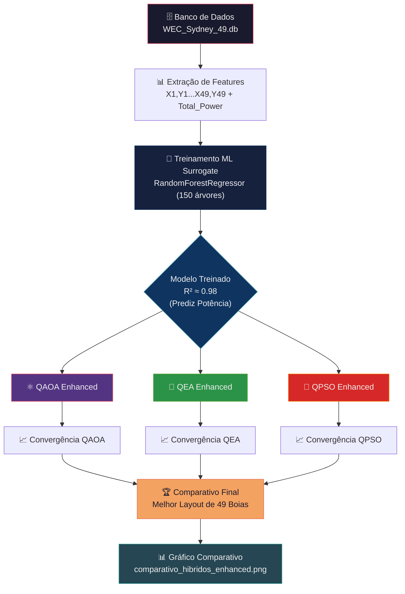
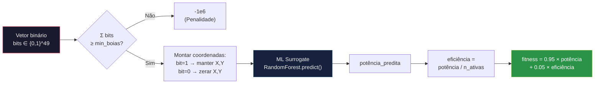
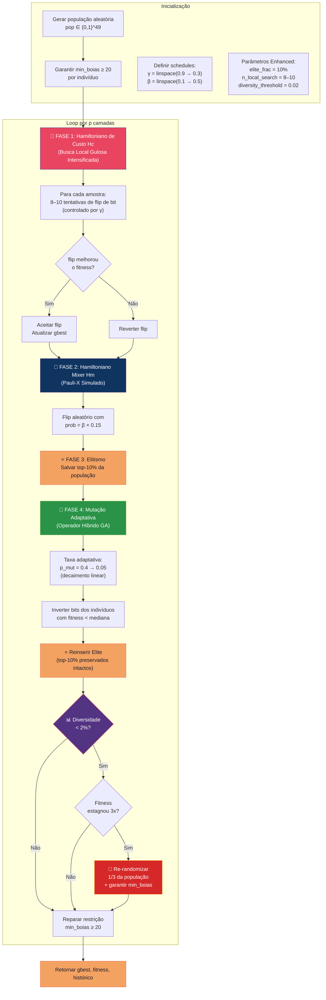
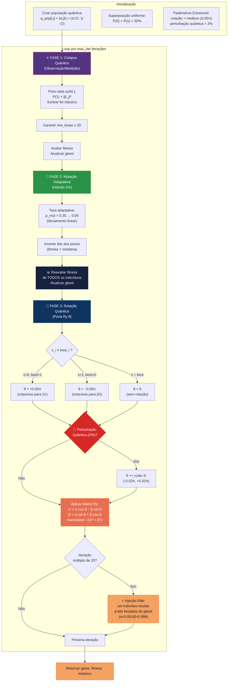
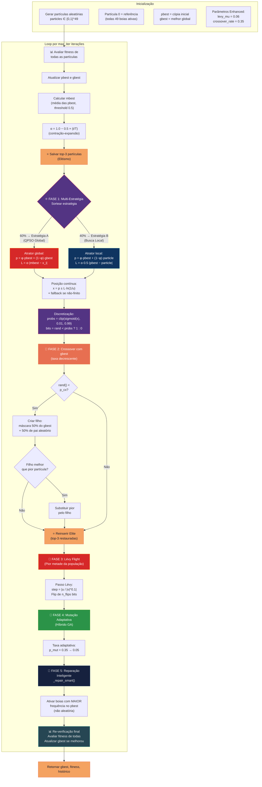
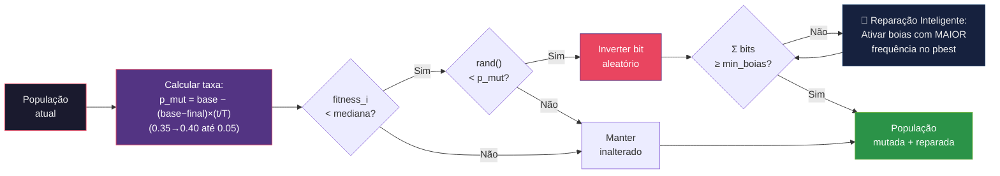

# Fluxograma — Algoritmos Híbridos Enhanced para Otimização de WECs

**Versão atualizada** — Reflete fielmente o código `algoritmos_hibridos_enhanced.py` + `shared_utils.py`

---

## 1. Visão Geral do Pipeline

---

## 2. Função de Fitness (Compartilhada)

---

## 3. Fluxo do QAOA Enhanced

---

## 4. Fluxo do QEA Enhanced

---

## 5. Fluxo do QPSO Enhanced

---

## 6. Componente Híbrido: Mutação Adaptativa + Reparação Inteligente

---

## 7. Legenda de Cores

| Cor | Significado |
|-----|-------------|
| 🟣 Roxo | Componentes quânticos (rotação, colapso, superposição, multi-estratégia) |
| 🔴 Vermelho | Hamiltoniano de custo / dinâmica de Schrödinger / Lévy Flight |
| 🔵 Azul | Hamiltoniano mixer / atratores / reparação inteligente |
| 🟢 Verde | Componente genético híbrido (mutação GA adaptativa) |
| 🟠 Laranja | Elitismo / crossover / resultados e saídas |
| 🟤 Teal | Verificações finais / re-avaliação |

---

## 8. Mapeamento Código ↔ Fluxograma

| Bloco do Fluxograma | Arquivo | Linhas |
|:---|:---|:---:|
| Função de Fitness | `shared_utils.py` | 28–48 |
| Mutação Adaptativa | `shared_utils.py` | 51–79 |
| Taxa Adaptativa | `algoritmos_hibridos_enhanced.py` | 75–78 |
| Reparação Inteligente | `algoritmos_hibridos_enhanced.py` | 58–72 |
| Diversidade | `algoritmos_hibridos_enhanced.py` | 52–55 |
| QAOA Enhanced | `algoritmos_hibridos_enhanced.py` | 85–197 |
| QEA Enhanced | `algoritmos_hibridos_enhanced.py` | 204–315 |
| QPSO Enhanced | `algoritmos_hibridos_enhanced.py` | 322–475 |
| ML Surrogate | `shared_utils.py` | 104–155 |
