# Relatorio de Resultados - Algoritmos Hibridos Quantico-Inspirados

## 1. Visao Geral

Relatorio gerado a partir de execucao real dos algoritmos.
Fonte de dados: `resultados_hibridos.json` (salvo automaticamente).

| Algoritmo | Tipo |
|---|---|
| Classic-PSO | Baseline - PSO Binario Classico |
| Standard-GA | Baseline - GA Padrao |
| QAOA-Hibrido | Base - Busca local + Mutacao GA |
| QEA-Hibrido | Base - Rotacao Q-bits + Mutacao GA |
| QPSO-Hibrido | Base - Poco Delta + Sigmoid + Mutacao GA |
| QAOA-Enhanced | Melhorado - Elitismo + Taxa adaptativa + Re-diversificacao |
| QEA-Enhanced | Melhorado - Tabela estendida + Perturbacao quantica |
| QPSO-Enhanced | Melhorado - Multi-strategy + Levy flight + Crossover |

## 2. Datasets

| Dataset | Boias | Iter | Pop | Min Boias | R2 | MAE | Potencia Original |
|---|---|---|---|---|---|---|---|
| WEC_Sydney_49.db | 49 | 60 | 25 | 20 | 0.9815 | 3,019 W | 4,145,252.22 W |
| WEC_Perth_49.db | 49 | 60 | 25 | 20 | 0.9507 | 10,264 W | 4,177,658.97 W |

## 3. Convergencia

### WEC_Sydney_49.db

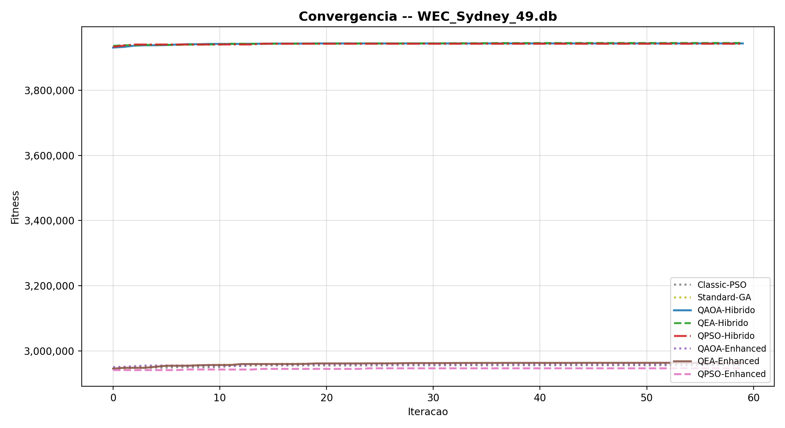

### WEC_Perth_49.db

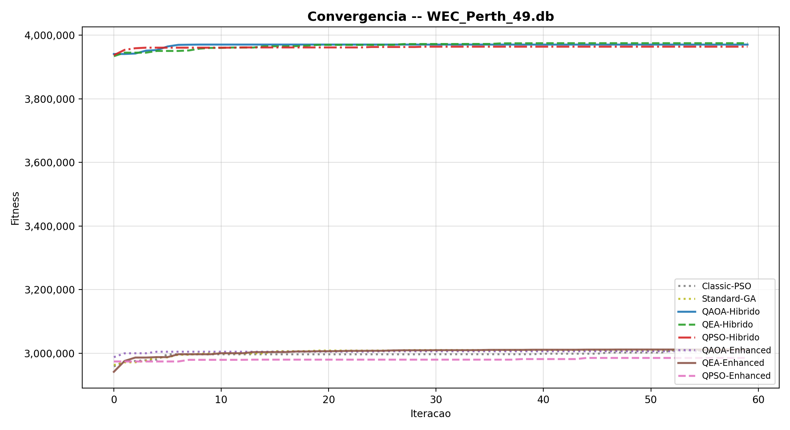

### Visao comparativa

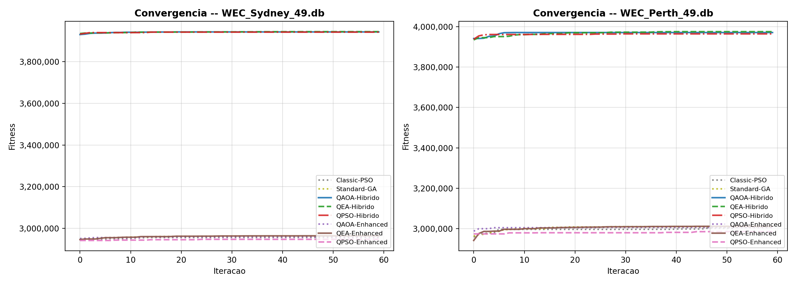

## 4. Resultados por Dataset

### WEC_Sydney_49.db

| Algoritmo | Fitness | Potencia | % Orig | Boias | Ef (W/boia) | Economia | Ganho Ef | Tempo |
|---|---|---|---|---|---|---|---|---|
| QEA-Hibrido **(melhor)** | 3,944,458.13 | 4,144,789.63 W | 100.0% | 30/49 | 138,159.65 | 38.8% | +63.3% | 93.3s |
| QAOA-Hibrido | 3,943,117.37 | 4,143,380.77 W | 100.0% | 30/49 | 138,112.69 | 38.8% | +63.3% | 206.0s |
| QPSO-Hibrido | 3,942,153.55 | 4,144,562.41 W | 100.0% | 43/49 | 96,385.17 | 12.2% | +13.9% | 48.7s |
| QEA-Enhanced | 2,964,077.41 | 4,130,119.76 W | 99.6% | 20/49 | 206,505.99 | 59.2% | +144.1% | 0.3s |
| Standard-GA | 2,962,285.56 | 4,122,897.67 W | 99.5% | 20/49 | 206,144.88 | 59.2% | +143.7% | 0.1s |
| QAOA-Enhanced | 2,959,206.95 | 4,115,620.14 W | 99.3% | 20/49 | 205,781.01 | 59.2% | +143.2% | 0.2s |
| Classic-PSO | 2,956,518.13 | 4,119,950.09 W | 99.4% | 20/49 | 205,997.50 | 59.2% | +143.5% | 0.1s |
| QPSO-Enhanced | 2,947,138.51 | 4,111,348.41 W | 99.2% | 21/49 | 195,778.50 | 57.1% | +131.4% | 0.1s |

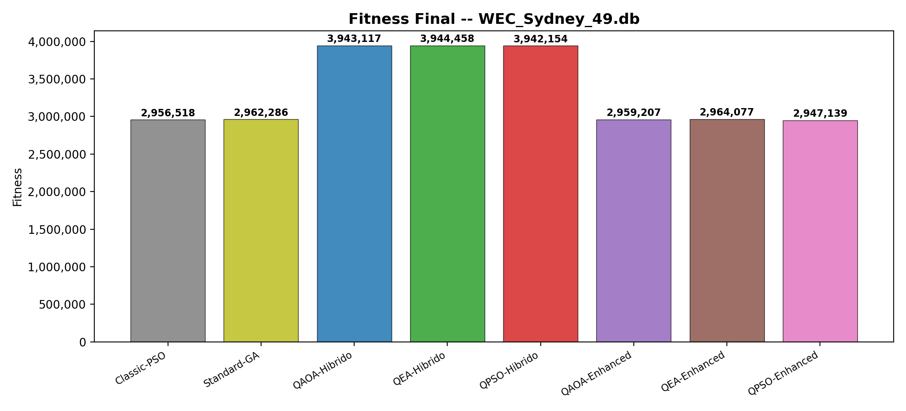

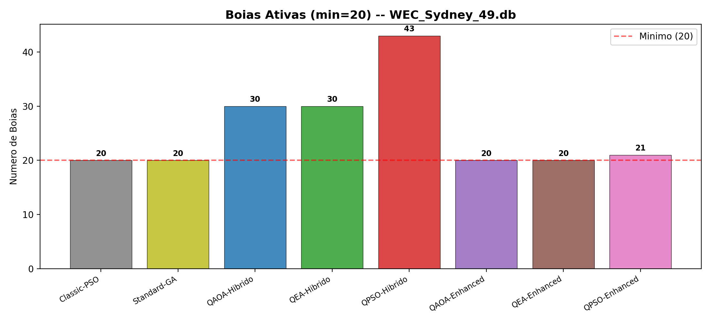

### Multi-criterio e Heatmap

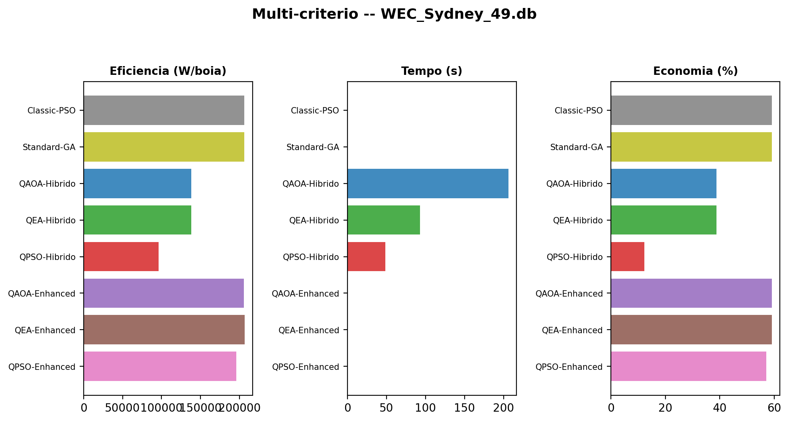

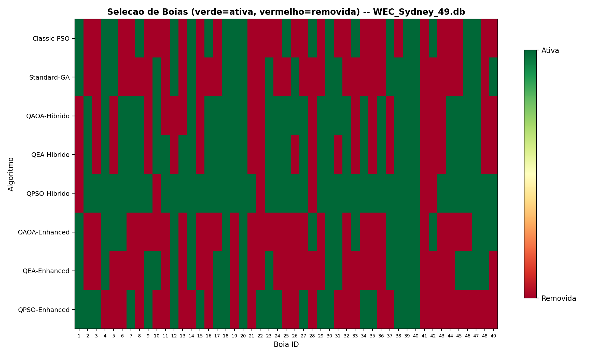

### WEC_Perth_49.db

| Algoritmo | Fitness | Potencia | % Orig | Boias | Ef (W/boia) | Economia | Ganho Ef | Tempo |
|---|---|---|---|---|---|---|---|---|
| QEA-Hibrido **(melhor)** | 3,974,919.64 | 4,177,658.97 W | 100.0% | 34/49 | 122,872.32 | 30.6% | +44.1% | 92.0s |
| QAOA-Hibrido | 3,970,556.10 | 4,172,877.43 W | 99.9% | 33/49 | 126,450.83 | 32.6% | +48.3% | 212.4s |
| QPSO-Hibrido | 3,963,966.83 | 4,166,669.68 W | 99.7% | 37/49 | 112,612.69 | 24.5% | +32.1% | 41.6s |
| QEA-Enhanced | 3,011,898.09 | 4,098,567.22 W | 98.1% | 20/49 | 204,928.36 | 59.2% | +140.4% | 0.1s |
| Standard-GA | 3,010,515.06 | 4,105,739.54 W | 98.3% | 20/49 | 205,286.98 | 59.2% | +140.8% | 0.1s |
| Classic-PSO | 3,009,055.41 | 4,092,217.58 W | 98.0% | 20/49 | 204,610.88 | 59.2% | +140.0% | 0.1s |
| QAOA-Enhanced | 3,006,463.49 | 4,100,957.99 W | 98.2% | 20/49 | 205,047.90 | 59.2% | +140.5% | 0.1s |
| QPSO-Enhanced | 2,985,448.83 | 4,118,337.48 W | 98.6% | 25/49 | 164,733.50 | 49.0% | +93.2% | 0.1s |

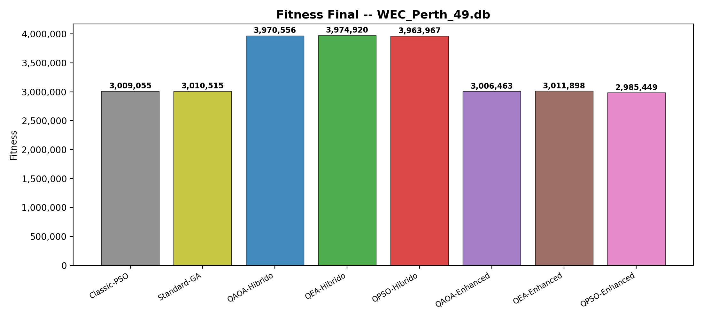

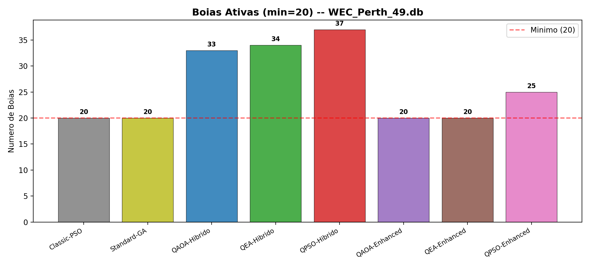

### Multi-criterio e Heatmap

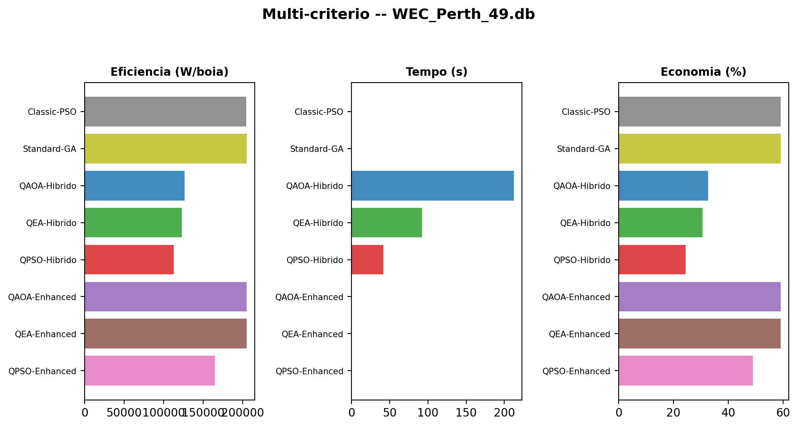

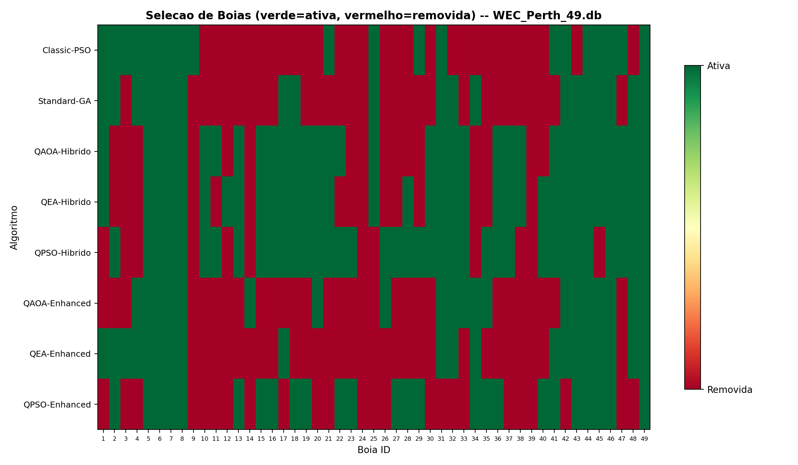

## 5. Comparacao Cross-Dataset

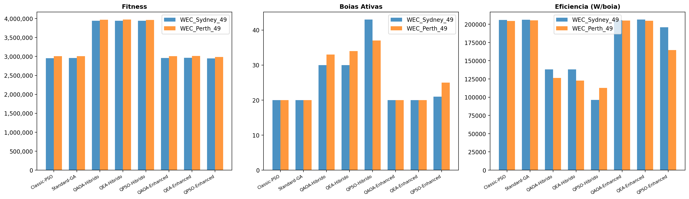

## 6. Analise

### WEC_Sydney_49.db

- **Melhor fitness:** QEA-Hibrido = 3,944,458.13
- **Mais economico:** Classic-PSO = 20/49 (59.2%)
- **Mais rapido:** Standard-GA = 0.1s
- **Amplitude fitness:** 25.284%
- QEA-Hibrido reteve 100.0% da potencia com 30/49 boias

### WEC_Perth_49.db

- **Melhor fitness:** QEA-Hibrido = 3,974,919.64
- **Mais economico:** Classic-PSO = 20/49 (59.2%)
- **Mais rapido:** Standard-GA = 0.1s
- **Amplitude fitness:** 24.893%
- QEA-Hibrido reteve 100.0% da potencia com 34/49 boias

### Conclusao

O **QEA-Hibrido** foi o mais consistente (2/2 datasets).

*Gerado automaticamente de execucao real -- 2 datasets x 8 algoritmos*